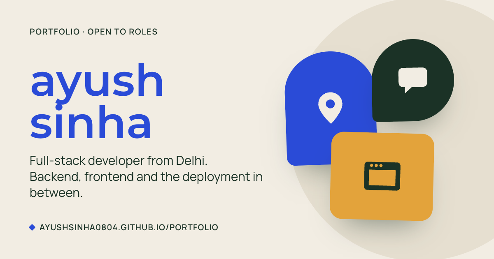

# Ayush Sinha — Portfolio

Personal portfolio of **Ayush Sinha**, a full-stack developer based in Delhi, India. It presents selected projects, case studies, work experience and contact details through an animated single-page application.

**Live site:** [ayushsinha0804.github.io/Portfolio](https://ayushsinha0804.github.io/Portfolio/)



---

## Features

- **Interactive project belt.** The home page shows projects as a 3D carousel that you can drag, scroll or steer with the keyboard. Each project has its own shape and colour.
- **Case-study pages.** Each project has its own page with its stack, highlights, metrics, screenshots and repository links.
- **Live GitHub activity.** A contribution calendar on the home page expands into a detailed card on hover. Its data is fetched at build time and refreshed daily.
- **Motion design.** The site uses page transitions, split-text reveals, smooth scrolling, scroll-linked parallax and a physics-based preloader.
- **Fast first load.** Routes are code-split and loaded on demand, and the preloader is tied to actual load progress.
- **Search and sharing.** Every route is prerendered to static HTML with its own title, description, canonical URL and social preview image. The build also generates a sitemap, `robots.txt` and structured data.
- **Accessibility.**
  - All motion respects `prefers-reduced-motion`.
  - Hover effects are limited to fine pointers.
  - Interactive elements work with the keyboard.
  - Colour pairs meet WCAG AA contrast.

## Tech stack

| Area | Tools |
| --- | --- |
| Framework | React 19, TypeScript, React Router |
| Build | Vite |
| Animation | GSAP (ScrollTrigger, SplitText, CustomEase), Lenis, Matter.js |
| Typography | Montserrat (headings), Manrope (body), self-hosted via Fontsource |
| Hosting | GitHub Pages, deployed with GitHub Actions |

## Getting started

**Requirements:** Node.js 24 or later and npm.

```bash
git clone https://github.com/ayushsinha0804/Portfolio.git
cd Portfolio
npm install
npm run dev
```

The development server runs at `http://localhost:5173/Portfolio/`.

### Scripts

| Command | Description |
| --- | --- |
| `npm run dev` | Start the development server with hot reload |
| `npm run build` | Type-check, build and prerender every route to `dist/` |
| `npm run preview` | Serve the production build locally |
| `npm run typecheck` | Run the TypeScript compiler without building |

## Project structure

```
├── .github/workflows/   Build and deployment pipeline
├── public/              Static assets: resume, favicon, share images, screenshots
├── scripts/
│   ├── contributions.ts Fetches the GitHub contribution calendar
│   └── postbuild.ts     Prerenders routes; writes sitemap, robots.txt and 404 page
└── src/
    ├── components/      Reusable UI and motion components
    ├── data/            Site content, page metadata and contribution data
    ├── lib/             Smooth scrolling, page transitions and shared helpers
    ├── pages/           Home, Work, Project, Experience, About, Contact
    └── styles/          Design tokens, base, component and page styles
```

## Updating content

All site content is data-driven, so most updates need no component changes.

| To change | Edit |
| --- | --- |
| Projects, experience, skills, education, contact links | `src/data/content.ts` |
| Page titles, descriptions and share images | `src/data/meta.ts` |
| Resume | Replace `public/Ayush_Sinha_Resume.pdf` |
| Project screenshots | `public/projects/` |
| Colours, type scale and easing curves | `src/styles/tokens.css` |

Each project's `bg` and `fg` colours set the colour of its card, its case-study page and its object on the home page belt.

## Deployment

The site deploys to GitHub Pages through `.github/workflows/deploy.yml`. The workflow runs:

- on every push to `master`
- once a day, to refresh the GitHub contribution calendar
- on demand, from the Actions tab

The site is served from the `/Portfolio/` sub-path, which is set by `base` in `vite.config.ts`. If you rename the repository, update that value and `SITE_URL` in `src/data/meta.ts`.

To deploy a fork, set **Settings → Pages → Source** to **GitHub Actions**.

## Contact

- **Email:** [ayushsxnha@gmail.com](mailto:ayushsxnha@gmail.com)
- **GitHub:** [@ayushsinha0804](https://github.com/ayushsinha0804)
- **LinkedIn:** [linkedin.com/in/ayushsxnha](https://www.linkedin.com/in/ayushsxnha/)
- **Website:** [ayushsinha0804.github.io/Portfolio](https://ayushsinha0804.github.io/Portfolio/)

For a full history of changes, see [CHANGELOG.md](CHANGELOG.md).
